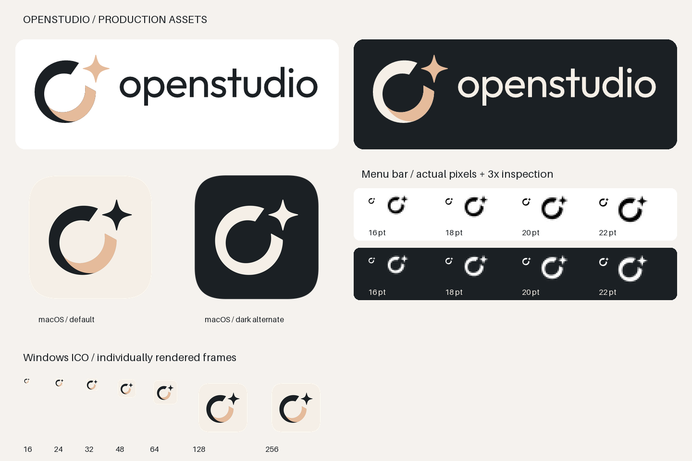

# OpenStudio identity

Production assets reconstructed as vector paths from the supplied OpenStudio branding board. No screenshot pixels are embedded. The canonical master is [`source/openstudio.svg`](source/openstudio.svg); every symbol, including the small monochrome versions, shares its ring and sparkle paths.



## Files

| Surface | Assets | Integration |
| --- | --- | --- |
| Website | `web/openstudio-logo-light.svg`, `web/openstudio-logo-dark.svg`; separate `openstudio-symbol-*.svg` | Outlined lowercase wordmark follows the reference. “Light” means a light **background**. No installed font required. |
| macOS application | `macos/openstudio-app-1024.png`, `macos/OpenStudio.icns`, `macos/OpenStudio.iconset/` | Integrated in `scripts/package_app.py` through `CFBundleIconFile`. Default cream tile has a 100/1024 outer margin, continuous-curvature corners, and transparent surroundings. Optional dark alternate is supplied, not automatically switched. |
| macOS asset catalog | `../macos/Assets.xcassets/` | Complete `AppIcon.appiconset` (16, 32, 128, 256, 512 pt at 1x/2x) and `MenuBarIcon.imageset` with template intent. `../macos/Branding.xcconfig` sets the AppIcon name for an Xcode target. |
| macOS menu bar | `macos/menubar-{16,18,20,22}.svg`, matching PNGs at 1x/2x | Native app loads the 18 pt / 36 px representations, sets `NSImage.isTemplate`, and lets macOS determine foreground color. No tile, gradient, shadow, or peach seam. |
| Windows application | `windows/OpenStudio.ico` | Seven independently rendered RGBA frames: 16, 24, 32, 48, 64, 128, 256. `OpenStudioResources.rc` and `.h` are ready to include in a Windows executable. |
| Windows notification area | `windows/tray-black.ico`, `windows/tray-white.ico`, corresponding SVGs/PNGs | Each ICO includes 16, 20, 24, 32, 40, 48, 64 px. Black for light taskbars, white for dark taskbars. Transparent, monochrome geometry. |
| Browser | `web/favicon.svg`, `favicon.ico`, `favicon-16x16.png`, `favicon-32x32.png` | SVG adapts to `prefers-color-scheme`; static fallback has a paper background for contrast in both themes. ICO contains 16, 32, 48 px. |
| Web app / touch | `web/apple-touch-icon.png` (180), `icon-192.png`, `icon-512.png`, `icon-maskable-512.png` | `site.webmanifest` and working `index.html` demonstrate integration. Touch/maskable assets have full opaque square backgrounds; the platform applies its mask. |

There is currently a native macOS application, but **no website or Windows application target** in this repository. The web page is a local preview, and the Windows resources are an integration kit, not a compiled Windows application. No unrelated application UI or names are changed.

## Native macOS integration

This repository packages a SwiftPM executable using command-line tools. Its app icon is the generated ICNS, and its menu images are copied into the SwiftPM resource bundle. The asset catalog is also provided for Xcode consumers, but is not treated as a runtime resource or misleadingly marked as a compiled Assets.car. Both paths use identical generated PNG inputs. The current host's `actool` cannot initialize its Xcode plugins; this does not affect the existing ICNS packaging path.

To use an Xcode target, add `macos/Assets.xcassets` to target membership and include `macos/Branding.xcconfig` (or set App Icons Source to `AppIcon`). Load `MenuBarIcon` as a template. The CLI build requires no asset-catalog compiler or design dependencies.

## Website integration

Copy the contents of `web/` into the website's public asset root and use the favicon, touch-icon, theme-color, and manifest tags in `web/index.html`. Adjust `id`, `start_url`, and `scope` together if the application is hosted below a subpath. Select the logo with a `<picture>` and `prefers-color-scheme`, as the preview does. Keep an accessible `alt="OpenStudio"`. The SVG wordmark is lowercase to match the board; product text can continue to use “OpenStudio”.

The 192/512 icons use `purpose: any`; the separate maskable 512 asset keeps all foreground geometry within the centered 80%-diameter safe circle. Do not pre-round touch or maskable icons. A manifest alone does not make the existing macOS app a PWA.

## Windows integration

Add `OpenStudioResources.rc` to the eventual executable project and this directory to the resource compiler's include/search paths. Load `IDI_OPENSTUDIO` for the application. For the tray, load `IDI_OPENSTUDIO_TRAY_BLACK` or `IDI_OPENSTUDIO_TRAY_WHITE` with `LoadImageW`, requesting the current DPI's small-icon size rather than upscaling a 16 px image. Use the taskbar/system theme, which may differ from the app theme, and reload on theme/DPI changes. On high-contrast themes, choose the variant contrasting with the actual taskbar background. Windows ICOs do not have macOS-style automatic template tinting.

## Source and reproduction

```sh
uv run scripts/generate_brand_assets.py
uv run scripts/verify_brand_assets.py
bash scripts/test.sh
bash scripts/build_app.sh
```

The generator has pinned, isolated design dependencies (`resvg-py` and Pillow); they are not added to the embedded Python runtime. Committed assets allow ordinary application builds without running the generator. Edit the canonical SVG's `ring`, `ribbon`, `sparkle`, or `wordmark` paths, then regenerate. `source/generated-assets.json` records source and output SHA-256 hashes so the verification step rejects stale or manually changed generated files. Small app representations use an optical enlargement; monochrome marks omit only the ribbon's color overlay. Brand colors are ink `#1B2024`, peach `#E5BB9B`, and paper `#F5EFE7`.

The wordmark uses outlined **Outfit Regular**, a close geometric interpretation rather than a claim to identify the reference image's original typeface. Source: [Google Fonts / Outfit](https://github.com/google/fonts/tree/main/ofl/outfit). Its SIL Open Font License is included in `source/WORDMARK-FONT-LICENSE.txt`. Outlining removes any runtime font dependency. The symbol was manually rebuilt as three Bézier paths.

## Verification scope

`verify_brand_assets.py` decodes PNG/ICO/ICNS contents, checks every requested resolution, transparency, monochrome foregrounds, separate ring/sparkle components at 16–22 pt, canonical SVG geometry, catalog metadata, copied resource equality, favicon links, resource links, and manifest targets. Native Swift tests check template intent and 1x/2x representations. Bundle smoke tests check that the installed resource paths and app-icon plist entry survive relocation. The preview includes both themes and actual-size menu symbols. Windows binary/runtime behavior is not tested on this macOS host.

Platform references: [Apple template images](https://developer.apple.com/documentation/appkit/nsimage/istemplate), [Apple app-icon configuration](https://developer.apple.com/documentation/xcode/configuring-your-app-icon), [Microsoft app icon sizes](https://learn.microsoft.com/en-us/windows/apps/design/style/iconography/app-icon-construction), [MDN manifest icons](https://developer.mozilla.org/en-US/docs/Web/Progressive_web_apps/Manifest/Reference/icons).
